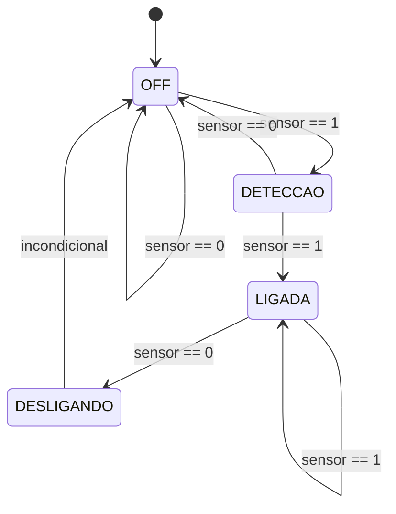

# Práticas de Circuitos Digitais em Verilog HDL

Repositório contendo implementações de circuitos digitais combinacionais e sequenciais desenvolvidos em **Verilog HDL**, com modelos e esquemáticos interativos gerados para simulação no **DigitalJS**.

---

## 📁 Estrutura do Repositório

```text
.
├── pratica01/                # Portas Lógicas Fundamentais
│   └── src/
│       ├── and_gate.v        # Porta AND (E)
│       ├── and_gate.digitaljs
│       ├── or_gate.v         # Porta OR (OU)
│       ├── or_gate.digitaljs
│       ├── not_gate.v        # Inversor NOT (NÃO)
│       ├── not_gate.digitaljs
│       ├── xor_gate.v        # Porta XOR (OU-Exclusivo)
│       └── xor_gate.digitaljs
├── pratica02/                # Circuitos Combinacionais (Multiplexador)
│   └── src/
│       ├── mux.v             # Multiplexador 2 para 1 (mux2x1)
│       └── mux.digitaljs
├── pratica03/                # Circuitos Sequenciais (Flip-Flop)
│   └── src/
│       ├── d_ff.v            # Flip-Flop Tipo D com sensibilidade à borda de subida
│       └── d_ff.digitaljs
├── pratica04/                # Máquina de Estados Finitos (FSM)
│   └── src/
│       ├── fsm.v             # FSM para controle automático de fluxo de água
│       └── fsm.digitaljs
└── README.md
```

---

## 🔬 Descrição das Práticas

### Prática 01: Portas Lógicas Básicas

Implementação das operações lógicas elementares utilizando atribuição contínua (`assign`):

| Módulo | Arquivo | Expressão Lógica | Descrição |
| :--- | :--- | :---: | :--- |
| `and_gate` | `pratica01/src/and_gate.v` | `y = a & b` | Saída ativa (`1`) somente se ambas as entradas forem `1`. |
| `or_gate` | `pratica01/src/or_gate.v` | `y = a \| b` | Saída ativa (`1`) se ao menos uma das entradas for `1`. |
| `not_gate` | `pratica01/src/not_gate.v` | `y = ~a` | Inverte o nível lógico da entrada. |
| `xor_gate` | `pratica01/src/xor_gate.v` | `y = a ^ b` | Saída ativa (`1`) se as entradas forem distintas. |

---

### Prática 02: Multiplexador 2:1 (`mux2x1`)

Implementação de um multiplexador de 2 canais de entrada de 1 bit com controle de seleção:

* **Arquivo**: `pratica02/src/mux.v`
* **Entradas**: `A` (canal 0), `B` (canal 1), `S` (seletor)
* **Saída**: `Y`
* **Lógica**: Operador condicional ternário `assign Y = S ? B : A;`

| Seletor (`S`) | Saída (`Y`) |
| :---: | :---: |
| `0` | `A` |
| `1` | `B` |

---

### Prática 03: Flip-Flop Tipo D (`d_ff`)

Implementação de um elemento de memória sequencial síncrono:

* **Arquivo**: `pratica03/src/d_ff.v`
* **Entradas**: `D` (dado), `clk` (sinal de clock)
* **Saída**: `Q` (registrador)
* **Comportamento**: A transferência do dado da entrada `D` para a saída `Q` ocorre exclusivamente na borda de subida do clock (`always @(posedge clk)`).

---

### Prática 04: Máquina de Estados Finitos (FSM - Controle de Torneira/Água)

Implementação de uma Máquina de Estados Finitos (FSM) síncrona projetada para controlar o acionamento de água (ex.: torneira automática com sensor de proximidade):

* **Arquivo**: `pratica04/src/fsm.v`
* **Entradas**: `clk` (clock), `sensor` (detecção de presença)
* **Saída**: `agua` (sinal de controle da válvula/saída de água)

#### Estados:
1. **`OFF` (`2'b00`)**: Estado inicial de repouso com água desligada. Se `sensor == 1`, avança para `DETECCAO`.
2. **`DETECCAO` (`2'b01`)**: Confirmação de leitura do sensor (debounce / estabilização). Se o sensor permanecer em `1`, transita para `LIGADA`. Caso contrário, retorna para `OFF`.
3. **`LIGADA` (`2'b10`)**: Válvula de água ativada (`agua = 1`). Permanece ligada enquanto `sensor == 1`. Quando `sensor == 0`, passa para `DESLIGANDO`.
4. **`DESLIGANDO` (`2'b11`)**: Estado de transição segura para desligamento. Transita de volta para `OFF`.



---

## 🛠️ Simulação e Visualização

### 1. Simulação Interativa via DigitalJS

Cada prática inclui um arquivo `.digitaljs` pronto com esquema elétrico interativo (botões, chaves e lâmpadas/indicadores):

1. **No VS Code**:
   * Instale a extensão **DigitalJS** (ou utilize o visualizador web em [DigitalJS Online](https://digitaljs.tilk.eu/)).
   * Abra qualquer arquivo `.digitaljs` ou gere a simulação diretamente a partir do código `.v`.
2. **Interação**:
   * Clique nos botões virtuais das entradas (`a`, `b`, `D`, `sensor`, etc.) para alternar seus valores lógicos e observe as lâmpadas e componentes reagirem em tempo real.

### 2. Simulação via Linha de Comando (Icarus Verilog)

Você também pode compilar e simular os módulos Verilog utilizando o **Icarus Verilog** (`iverilog`):

```bash
# Exemplo para validar a sintaxe e compilar o módulo da FSM
iverilog -Wall -g2012 -o fsm_sim.out pratica04/src/fsm.v
```

---

## 📋 Pré-requisitos

* [Icarus Verilog](https://steveicarus.github.io/iverilog/) (`iverilog`)
* [GTKWave](https://gtkwave.sourceforge.net/) (para visualização de ondas VCD)
* [Extensão DigitalJS](https://marketplace.visualstudio.com/items?itemName=tilk.digitaljs) para VS Code ou acesso ao [DigitalJS Online](https://digitaljs.tilk.eu/)
